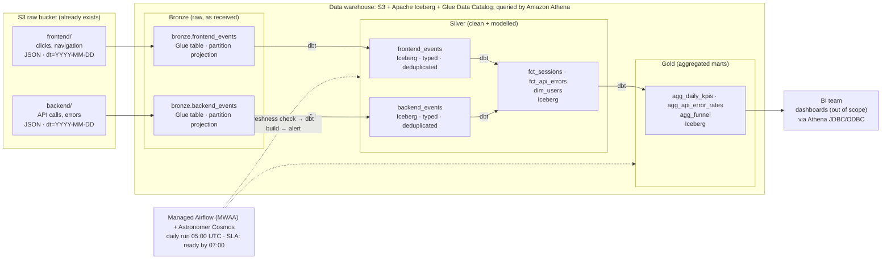
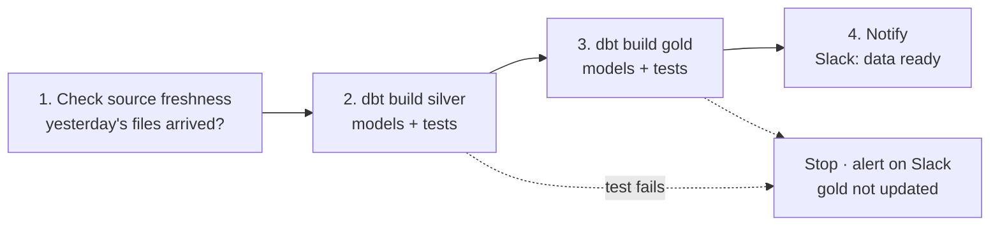

# Case 1: Data Architecture for a Startup

> **Goal:** ingest frontend and backend events from S3, transform them, and deliver reliable, structured tables in a central data warehouse, ready for the BI team every morning.
> **Constraints:** 2 engineers · 1 week · volume and format unknown · data ready early in the morning · AWS.

---

## 1. Architecture

**Platform foundations (apply to every layer):**

| Concern | Stack |
|---|---|
| Infrastructure as Code | **Terraform**: S3, Glue databases and bronze tables, Athena workgroups, IAM, Lake Formation, MWAA |
| CI/CD | **GitLab CI**: lint, test and deploy for dbt, DAGs and Terraform |
| Transformation | **dbt Core + dbt-athena** (SQL runs on Athena) |
| Data quality | **dbt tests**: source freshness, generic, singular and unit tests |
| Governance and security | **IAM** (least privilege), **Lake Formation** (table/column access), **KMS** (encryption), **CloudTrail** (audit) |
| Observability | Airflow failure and SLA alerts to **Slack**, **CloudWatch** metrics, dbt run artifacts |
| Cost control | **Athena workgroups** with per-query scan limits, Iceberg partitioning, S3 lifecycle rules |

---

## 2. Why this stack

**Overall: a serverless lakehouse on AWS**
- **Fewest moving parts.** Data already lives in S3, so Athena queries it where it is. There's no separate loading service to build or operate.
- **No servers to manage.** Athena, Glue, S3 and MWAA are all managed. The 2 engineers spend the week on data, not infrastructure.
- **Pay per query.** No idle compute cost, which suits a startup whose volume isn't known yet.
- **Open format.** Iceberg tables in our own S3 bucket can be read by other engines (Snowflake, Spark) later, with no lock-in and no migration.

**Per layer**
- **Bronze: Glue tables over the raw JSON**
  - Defined **once in Terraform**, not recreated daily.
  - **Partition projection** means Athena computes partitions from the `dt=` path pattern, so no daily `ALTER TABLE ADD PARTITION` or crawler is needed. That removes a whole failure point.
  - Data is kept exactly as received, so any downstream table can be rebuilt.
- **Silver: cleaned and modelled Iceberg tables built by dbt**
  - **Cleaned events:** parses the JSON into typed columns, standardises timestamps to UTC, hashes PII.
  - **Deduplicates on `event_id`** with an incremental `MERGE`, using a **3-day lookback window** so late-arriving events are still captured.
  - **Facts and dimensions:** `fct_sessions`, `fct_api_errors` and `dim_users` join frontend and backend events (for example sessions with their API errors).
  - Analysts can query silver directly for custom analysis.
  - Iceberg gives ACID transactions, `MERGE` and time travel on top of S3.
- **Gold: aggregated marts built by dbt**
  - Aggregated tables only (daily KPIs, error rates, funnel), built from silver facts and dimensions.
  - Ready for dashboards, so they stay fast and cheap.
  - Partitioned by `event_date`, so queries scan only the days they need.
- **Orchestration: managed Airflow + Cosmos**
  - Cosmos turns every dbt model and test into an Airflow task, so failures are visible per model and retries are granular.
  - Daily schedule fits the requirement: data must be ready in the morning, not in real time.

---

## 3. Daily pipeline (Airflow DAG)

- **05:00 UTC run, ready by 07:00.** That leaves 2 hours of buffer for a retry or a manual fix before BI starts.
- `dbt build` runs each model's tests right after it. **A failing test stops everything downstream**, so BI never sees bad data. They see yesterday's correct data and an alert instead.
- **Weekly maintenance DAG:** Iceberg `OPTIMIZE` (compacts small files) and `VACUUM` (expires old snapshots), which keep queries fast and storage costs low.

---

## 4. Reliability: how we make the data trustworthy

| Check | Where | Example |
|---|---|---|
| **Source freshness** | Bronze | Fails if no new files arrived for yesterday |
| **Generic tests** | Silver, gold | `event_id` unique and not null; `event_type` in the accepted values |
| **Singular tests** | Silver, gold | Daily event count not down more than 50% from the previous day (catches a broken tracker) |
| **Unit tests** | Silver, gold | Session logic gives the expected output on a fixed input |
| **Alerting** | Airflow | Slack on any failure, plus a **missed-SLA alert at 07:00** |

---

## 5. Security and governance

- **Least-privilege IAM:** separate roles for Airflow/dbt (read raw, write silver and gold) and BI (read gold only).
- **Lake Formation:** table- and column-level access. BI sees gold; analysts can see silver; PII columns are restricted.
- **PII:** user identifiers and IPs are hashed in silver.
- **Encryption:** KMS on all buckets and Athena query results.
- **Audit:** CloudTrail logs who queried what.
- **Separate Athena workgroups** for transformation and BI: isolated costs and per-query scan limits.

---

## 6. Environments, IaC and CI/CD

- **Two environments, dev and prod**: separate Glue databases and S3 prefixes, selected by dbt target.
- **Everything in Terraform**, so the setup is repeatable and reviewable.
- **GitLab CI on every merge request:**
  - SQL lint (SQLFluff) and `dbt compile`
  - `dbt build --select state:modified+` in a temporary CI schema, which builds and tests only what changed
  - `terraform plan`, posted to the merge request
- **On merge to `main`:** deploy dbt and DAGs to Airflow, then `terraform apply`.

---

## 7. Trade-offs

| Choice | Benefit | Cost / risk | Mitigation |
|---|---|---|---|
| Athena, not a loaded warehouse | No loading step, serverless, pay per query | Cost grows with data scanned; dashboard queries are slower than in a dedicated warehouse | Partitioned Iceberg tables, pre-aggregated gold, workgroup scan limits |
| Daily batch, not streaming | Simple, cheap, meets "ready in the morning" | Data is up to 1 day old | Increase the schedule to hourly if needed, with no redesign |
| Iceberg for silver and gold | ACID, MERGE, time travel, open format | Needs periodic maintenance | Weekly OPTIMIZE and VACUUM DAG |
| Managed Airflow (MWAA) | Standard orchestrator, grows with the platform | Fixed monthly cost, more than a simple scheduler | Pays off as soon as there are several pipelines |
| Land raw JSON as-is | Never breaks on schema changes | Parsing work moves to silver | Schema handled in dbt, with tests on key fields |

---

## 8. Snowflake: considered for later

- **Why not now:** Snowflake needs an extra loading layer (Snowpipe, stage, storage integration) and keeps a second copy of the data. For 2 engineers and one week, querying in place with Athena has fewer moving parts.
- **When it makes sense:** more BI users and concurrency, heavier dashboards, a need for predictable performance, or more advanced governance.
- **First step, no data migration:** Snowflake can read our existing **Iceberg tables on S3 directly through the Glue Data Catalog**, so we can trial it on the same data.
- **Limitation:** in this mode Glue stays the owner of the tables. Snowflake reads them, but writes and table maintenance stay on the AWS side, and we don't get Snowflake's full feature set. A full move to Snowflake would mean making Snowflake the owner of the silver and gold tables, which is a planned migration step and not part of this case.

---

## 9. Delivering in one week with 2 engineers

| Day | Engineer A | Engineer B |
|---|---|---|
| **1** | Kick-off with the CEO and BI: agree the **3–5 priority KPIs** and the event schema | Terraform foundations: S3, Glue, Athena workgroups, IAM |
| **2** | Bronze tables + partition projection; profile the raw data | MWAA + Cosmos set up; GitLab CI skeleton |
| **3–4** | dbt silver models + tests | dbt gold models for the priority KPIs + tests |
| **5** | End-to-end run in dev; fix data issues | Alerting, SLA, Lake Formation access for BI |
| **6** | Deploy to prod; backfill history | BI team validates the gold tables |
| **7** | Buffer, documentation, handover | Buffer, documentation, handover |

- **Priorities:** the KPIs the CEO needs come first. Everything else (more marts, advanced monitoring) follows in week 2.
- **Daily 15-minute sync** between the 2 engineers and a short check-in with BI to catch misunderstandings early.
- **Deliberately not in week 1:** streaming, a data catalog UI, complex data observability tools.

---

## 10. Assumptions and day-1 questions

| Topic | Assumption | If it's wrong |
|---|---|---|
| Format | JSON (possibly gzipped), partitioned by date in S3 | Parquet makes it simpler and cheaper; CSV needs stricter schema checks |
| Freshness | Yesterday's data ready by 07:00 | Hourly runs are a schedule change, not a redesign |
| Volume | Startup scale: GBs to low hundreds of GBs per day | At TB/day, partitioning and incremental models matter even more |
| Schema | Changes often; frontend and backend differ | Raw JSON is landed as-is; parsing in dbt absorbs the changes |
| Quality | Duplicates and late-arriving events exist | Dedup on `event_id`, 3-day lookback window |
| History | Existing S3 history must be backfilled | One-off full build, then incremental |

**Questions for day 1:** Which KPIs come first? What does the event schema look like, and how much data is there? Which fields are personal data (GDPR)? Which time zone does "early morning" mean? How much history is needed?
