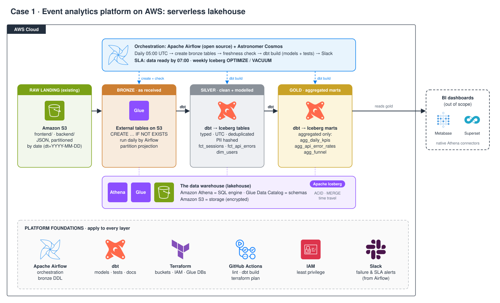
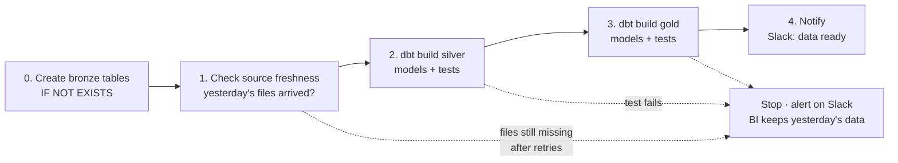

# Case 1: Data Architecture for a Startup

> **Goal:** ingest frontend and backend events from S3, transform them, and deliver reliable, structured tables in a central data warehouse, ready for the BI team every morning.
> **Constraints:** 2 engineers · 1 week · volume and format unknown · data ready early in the morning · AWS.

---

## 1. Architecture



**Platform foundations (apply to every layer):**

| Concern | Stack |
|---|---|
| Orchestration | **Apache Airflow + Cosmos**: runs the daily pipeline, creates the bronze tables, sends alerts |
| Transformation | **dbt Core + dbt-athena** (SQL runs on Athena) |
| Data quality | **dbt tests**: source freshness, YAML tests, singular tests on source data, unit tests |
| Infrastructure as Code | **Terraform**: S3 buckets, IAM roles, Glue databases, Athena workgroups |
| CI/CD | **GitHub Actions**: lint, test and deploy for dbt, DAGs and Terraform |
| Security | **IAM** least-privilege roles; S3 encryption enabled by default |
| Alerting | **Airflow → Slack** on any failure or missed SLA |

---

## 2. Why this stack

**Overall: a serverless lakehouse on AWS**
- **Fewest moving parts.** Data already lives in S3, so Athena queries it where it is. There's no separate loading service to build or operate.
- **Serverless data layer.** Athena, Glue and S3 are fully managed. Only Airflow runs as a small container, and it only orchestrates; the heavy work runs on Athena. The 2 engineers spend the week on data, not infrastructure.
- **Pay per query.** No idle compute cost, which suits a startup whose volume isn't known yet.
- **Open format.** Iceberg tables in our own S3 bucket can be read by other engines (Snowflake, Spark) later, with no lock-in and no migration.

**Per layer**
- **Bronze: Glue tables over the raw JSON**
  - Created by the **first Airflow task** with `CREATE EXTERNAL TABLE IF NOT EXISTS`. It's safe to run every day, and the DDL lives in the repo next to the dbt code, owned by the data team.
  - **Partition projection** is configured in that same `CREATE` statement, as table properties. Athena then works out the partitions from the `dt=` path itself, so there's **no `ALTER TABLE ADD PARTITION`, no crawler and no daily partition step**.
  - Data is kept exactly as received, so any downstream table can be rebuilt.
  - If the schema changes, we drop and recreate the external table. That's safe because it only touches metadata, never the files in S3.

  ```sql
  CREATE EXTERNAL TABLE IF NOT EXISTS bronze.frontend_events (
      event_id string, event_type string, user_id string, ts string, payload string
  )
  PARTITIONED BY (dt string)
  ROW FORMAT SERDE 'org.openx.data.jsonserde.JsonSerDe'
  LOCATION 's3://raw-events/frontend/'
  TBLPROPERTIES (
      'projection.enabled'          = 'true',
      'projection.dt.type'          = 'date',
      'projection.dt.format'        = 'yyyy-MM-dd',
      'projection.dt.range'         = '2025-01-01,NOW',
      'storage.location.template'   = 's3://raw-events/frontend/dt=${dt}/'
  );
  ```
- **Silver: cleaned and modelled Iceberg tables built by dbt**
  - **Cleaned events:** parses the JSON into typed columns, standardises timestamps to UTC, hashes PII.
  - **Deduplicates on `event_id`** with an incremental `MERGE`, using a **3-day lookback window** so late-arriving events are still captured.
  - **Facts and dimensions:** `fct_sessions`, `fct_api_errors` and `dim_users` join frontend and backend events (for example sessions with their API errors).
  - Analysts can query silver directly for custom analysis.
  - Iceberg gives ACID transactions, `MERGE` and time travel on top of S3.
- **Gold: aggregated marts built by dbt**
  - Aggregated tables only (daily KPIs, error rates, funnel), built from silver facts and dimensions.
  - Ready for dashboards, so they stay fast and cheap.
  - Partitioned by `event_date`, so queries scan only the days they need.
- **Orchestration: Apache Airflow (open source) + Cosmos**
  - Cosmos turns every dbt model and test into an Airflow task, so failures are visible per model and retries are granular.
  - Daily schedule fits the requirement: data must be ready in the morning, not in real time.
  - Open source: no licence cost, and the industry-standard orchestrator.
- **Consumption: BI tools on top of Athena**
  - Metabase and Apache Superset both connect natively to Athena, so the BI team works directly on the gold tables. Dashboards themselves are out of scope.

---

## 3. Daily pipeline (Airflow DAG)



- **05:00 UTC run, ready by 07:00.** That leaves 2 hours of buffer for a retry or a manual fix before BI starts.
- **Late files:** the freshness check retries (e.g. every 15 minutes until 06:30). If yesterday's files still haven't arrived, the run stops and Slack alerts "source late". Nothing is rebuilt, so BI keeps yesterday's complete data instead of a partial day; once the files land, we rerun the DAG.
- `dbt build` runs each model's tests right after it. **A failing test stops everything downstream**, so BI never sees bad data. They see yesterday's correct data and an alert instead.
- **Weekly maintenance DAG:** Iceberg `OPTIMIZE` (compacts small files) and `VACUUM` (expires old snapshots), which keep queries fast and storage costs low.

---

## 4. Reliability: how we make the data trustworthy

| Check | Where | Example |
|---|---|---|
| **Source freshness** | Bronze (dbt sources) | Fails if no new files arrived for yesterday |
| **Generic tests in YAML** | Silver, gold | Declared in each model's `.yml`: `event_id` unique and not null, `event_type` in accepted values, `user_id` exists in `dim_users` |
| **Singular tests on source data** | Bronze (the raw S3 data, through the Glue tables) | No events with a future timestamp; daily event count not down more than 50% from the previous day (catches a broken tracker) |
| **Unit tests** | Silver, gold | Session logic gives the expected output on a fixed input |
| **Alerting** | Airflow → Slack | Message on any failure, plus a **missed-SLA alert at 07:00** |

**dbt best practices**
- **Clear structure and naming:** one folder per layer. Silver holds `fct_` and `dim_` models; gold holds `agg_` marts.
- **Tests and docs live in YAML, next to each model:** descriptions for every model and key column, plus the generic tests. `dbt docs generate` gives BI a browsable catalog with lineage.
- **`dbt build`, not `run` then `test`:** each model is tested right after it's built, and a failure stops everything downstream.
- **Parameterised incremental loads for selective backfills:** incremental models read optional `start_date` / `end_date` variables. By default they process the last 3 days (the lookback window). To reprocess a specific period, pass dates and only that range is rebuilt, with no full refresh:

  ```bash
  dbt build --select fct_sessions+ --vars '{start_date: "2026-01-01", end_date: "2026-01-31"}'
  ```

- **One source at a time:** when a fact unions several sources, each source's logic sits in its own macro, named after the source. An optional `source` variable rebuilds just that one (empty = all), and it combines with the dates:

  ```bash
  dbt build --select fct_sessions+ --vars '{source: app_sessions, start_date: "2026-01-01", end_date: "2026-01-31"}'
  ```

---

## 5. Security and governance

- **Least-privilege IAM roles:** Airflow/dbt can read raw and write silver and gold; BI can read gold (and silver for analysts).
- **PII:** user identifiers and IPs are hashed in silver.
- **Encryption:** S3 default encryption on all buckets and Athena query results.
- **Separate Athena workgroups** for transformation and BI: isolated costs and per-query scan limits.
- **Later, if needed:** Lake Formation for column-level permissions.

---

## 6. Environments, IaC and CI/CD

- **Two environments, dev and prod**: separate Glue databases and S3 prefixes, selected by dbt target.
- **Infrastructure in Terraform** (buckets, IAM roles, Glue databases, Athena workgroups), so the setup is repeatable and reviewable.
- **Tables belong to the data code, not Terraform:** bronze DDL runs from Airflow, and silver and gold are built by dbt. A schema change is a normal data pull request, not an infrastructure deployment.
- **GitHub Actions on every pull request:**
  - SQL lint (SQLFluff) and `dbt compile`
  - `dbt build --select state:modified+` in a temporary CI schema, which builds and tests only what changed
  - `terraform plan`, posted to the pull request
- **On merge to `main`:** deploy dbt and DAGs to Airflow, then `terraform apply`.

---

## 7. Trade-offs

| Choice | Benefit | Cost / risk | Mitigation |
|---|---|---|---|
| Athena, not a loaded warehouse | No loading step, serverless, pay per query | Cost grows with data scanned; dashboard queries are slower than in a dedicated warehouse | Partitioned Iceberg tables, pre-aggregated gold, workgroup scan limits |
| Daily batch, not streaming | Simple, cheap, meets "ready in the morning" | Data is up to 1 day old | Increase the schedule to hourly if needed, with no redesign |
| Iceberg for silver and gold | ACID, MERGE, time travel, open format | Needs periodic maintenance | Weekly OPTIMIZE and VACUUM DAG |
| Apache Airflow (open source) | Standard orchestrator, no licence cost, grows with the platform | We run and upgrade it ourselves | Small containerised setup (single service); move to a managed offering if operations become a burden |
| Land raw JSON as-is | Never breaks on schema changes | Parsing work moves to silver | Schema handled in dbt, with tests on key fields |

---

## 8. Snowflake: considered for later

- **Why not now:** Snowflake needs an extra loading layer (Snowpipe, stage, storage integration) and keeps a second copy of the data. For 2 engineers and one week, querying in place with Athena has fewer moving parts.
- **When it makes sense:** more BI users and concurrency, heavier dashboards, a need for predictable performance, or more advanced governance.
- **First step, no data migration:** Snowflake can read our existing **Iceberg tables on S3 directly through the Glue Data Catalog**, so we can trial it on the same data.
- **Limitation:** in this mode Glue stays the owner of the tables. Snowflake reads them, but writes and table maintenance stay on the AWS side, and we don't get Snowflake's full feature set. A full move to Snowflake would mean making Snowflake the owner of the silver and gold tables, which is a planned migration step and not part of this case.

---

## 9. Delivering in one week with 2 engineers

| Day | Engineer A | Engineer B |
|---|---|---|
| **1** | Kick-off with the CEO and BI: agree the **3–5 priority KPIs** and the event schema | Terraform foundations: S3, IAM, Glue databases, Athena workgroups |
| **2** | Bronze DDL (IF NOT EXISTS + partition projection); profile the raw data | Airflow + Cosmos set up; GitHub Actions skeleton |
| **3–4** | dbt silver models + tests | dbt gold models for the priority KPIs + tests |
| **5** | End-to-end run in dev; fix data issues | Slack alerting, SLA, IAM access for BI |
| **6** | Deploy to prod; backfill history | BI team validates the gold tables |
| **7** | Buffer, documentation, handover | Buffer, documentation, handover |

- **Priorities:** the KPIs the CEO needs come first. Everything else (more marts, advanced monitoring) follows in week 2.
- **Daily 15-minute sync** between the 2 engineers and a short check-in with BI to catch misunderstandings early.
- **Deliberately not in week 1:** streaming, a data catalog UI, complex data observability tools.

---

## 10. Assumptions and day-1 questions

| Topic | Assumption | If it's wrong |
|---|---|---|
| Format | JSON (possibly gzipped), partitioned by date in S3 | Parquet makes it simpler and cheaper; CSV needs stricter schema checks |
| Freshness | Yesterday's data ready by 07:00 | Hourly runs are a schedule change, not a redesign |
| Volume | Startup scale: GBs to low hundreds of GBs per day | At TB/day, partitioning and incremental models matter even more |
| Schema | Changes often; frontend and backend differ | Raw JSON is landed as-is; parsing in dbt absorbs the changes |
| Quality | Duplicates and late-arriving events exist | Dedup on `event_id`, 3-day lookback window |
| History | Existing S3 history must be backfilled | One-off full build, then incremental |

**Questions for day 1:** Which KPIs come first? What does the event schema look like, and how much data is there? Which fields are personal data (GDPR)? Which time zone does "early morning" mean? How much history is needed?
