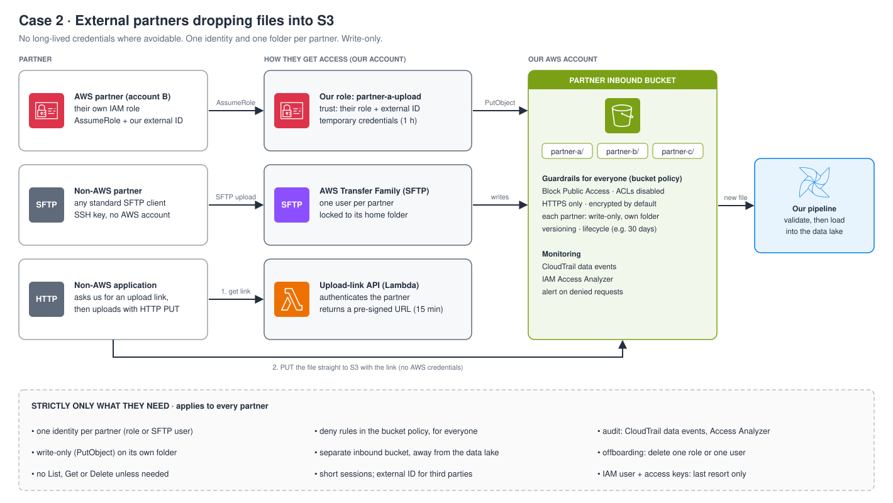

# Case 2: Authentication and Authorisation on S3

> **Goal:** let external partners drop files into our S3 bucket, some from another AWS account and some from outside AWS, while each partner can do **strictly only what it needs**.
> **Principles:** no long-lived credentials where avoidable · one identity and one folder per partner · write-only · everything controlled from our account.

---

## 1. Overview



| Partner | Mechanism | Credentials the partner holds |
|---|---|---|
| **On AWS** (another account) | **IAM role in our account**, assumed by the partner's role, with an external ID | None: temporary credentials issued by AWS on each session |
| **Not on AWS**, sends files regularly | **SFTP** through AWS Transfer Family | An SSH key, valid only for its own folder |
| **Not on AWS**, an application | **Pre-signed URLs** from a small upload-link API | A temporary link per file |
| **Not on AWS**, no other option | IAM user with access keys | Long-lived keys: **last resort only** |

All partners write to a **dedicated inbound bucket**, one folder (prefix) per partner. Our pipeline picks up new files, validates them and loads them into the data lake. **Partners never access the data lake.**

Illustrative Terraform for the bucket, the cross-account role, SFTP and the pre-signed URL Lambda: [`.cloud/terraform/case-study-2/`](../.cloud/terraform/case-study-2/).

---

## 2. AWS partner in another account

### The mechanism: a cross-account IAM role, assumed through STS

We create **one IAM role per partner in our account**. The partner's own role is allowed to **assume** it, and AWS STS returns **temporary credentials** (valid 1 hour by default). No access key is ever created or shared.

### How it works concretely

| Step | Who | What |
|---|---|---|
| 1 | Us | Create the role `partner-a-upload` with a **trust policy** naming the partner's role and requiring an **external ID** |
| 2 | Us | Attach a **permissions policy**: write-only on the partner's folder |
| 3 | Partner | Allow their role to call `sts:AssumeRole` on our role ARN |
| 4 | Partner | From their own role, assume ours (passing the external ID), get temporary credentials, upload |

**1. Trust policy and role (our account): who can assume it**

```hcl
data "aws_iam_policy_document" "partner_a_assume_role" {
  statement {
    sid     = "PartnerAAssumeRole"
    effect  = "Allow"
    actions = ["sts:AssumeRole"]

    principals {
      type        = "AWS"
      identifiers = [var.partner_a_role_arn] # their specific role, not their whole account
    }

    condition {
      test     = "StringEquals"
      variable = "sts:ExternalId"
      values   = [var.partner_a_external_id]
    }
  }
}

resource "aws_iam_role" "partner_a_upload" {
  name               = "partner-a-upload-${var.env}"
  assume_role_policy = data.aws_iam_policy_document.partner_a_assume_role.json
}
```

- We trust the partner's **specific role**, not their account root (`:root`), which would let any identity their admins choose assume our role.

**2. Permissions (our role): what it can do**

```hcl
  statement {
    sid       = "WriteOwnFolderOnly"
    effect    = "Allow"
    actions   = ["s3:PutObject"]
    resources = ["${aws_s3_bucket.partner_inbound.arn}/partner-a/*"]
  }
```

**3. Partner side: their role may assume ours**

```hcl
  statement {
    sid       = "AssumeGroupUploadRole"
    effect    = "Allow"
    actions   = ["sts:AssumeRole"]
    resources = ["arn:aws:iam::<OUR_ACCOUNT>:role/partner-a-upload-prod"]
  }
```

**4. Partner side: uploading.** Their code runs **as their own role** (for example the role attached to their EC2 instance, container or Lambda). From there it makes **two hops**: their role → our role → S3.

```python
import boto3

# Hop 1: runs with the partner's own role credentials (picked up automatically on EC2, ECS or Lambda)
sts = boto3.client("sts")
creds = sts.assume_role(
    RoleArn="arn:aws:iam::<OUR_ACCOUNT>:role/partner-a-upload-prod",
    RoleSessionName="partner-a",
    ExternalId="<external-id>",
)["Credentials"]

# Hop 2: temporary credentials of OUR role, valid 1 hour
s3 = boto3.client(
    "s3",
    aws_access_key_id=creds["AccessKeyId"],
    aws_secret_access_key=creds["SecretAccessKey"],
    aws_session_token=creds["SessionToken"],
)
s3.upload_file("orders.csv", "partner-inbound", "partner-a/2026-11-15/orders.csv")
```

The AWS CLI can do the same with a profile (`role_arn` + `external_id`, starting from the role attached to their machine with `credential_source = Ec2InstanceMetadata`).

### Why the external ID

If the partner is a **service acting for many clients** with one central role (a file-transfer platform, a data provider), another of its clients could give it **our** role ARN and use the partner to reach our bucket. This is the **confused deputy** problem.

- The partner gives each client a **unique external ID** the client can't choose, and always sends the ID of the client it's working for.
- Our trust policy accepts **only our ID**, so a request made for another client is denied.
- It costs nothing, so we **require it for every third party**.

### Why a role rather than a bucket policy

A bucket policy naming the partner's role also works without credentials. Both sides must allow the action, and our bucket policy sets the maximum. We still prefer the role:

| | Role in our account (chosen) | Bucket policy |
|---|---|---|
| Where permissions live | Only in our account; the partner only holds "may assume role X" | Our bucket policy, repeated in the partner's IAM policy |
| Isolation | One role and role policy per partner (own folder); change or remove one without touching the others | All partners in one shared policy: an edit can affect everyone (20 KB limit) |
| Confused deputy protection | External ID supported | No equivalent |
| Audit | Each session appears as our role in our CloudTrail | Requests appear as the partner's identity |
| Partner effort | One extra step: assume the role | Slightly simpler |

---

## 3. Partner not on AWS

The partner has no AWS identity, so it can't assume a role directly. Four options, from preferred to last resort.

### Option A: SFTP through AWS Transfer Family (default for regular file exchanges)

- **What it is:** SFTP is the long-standing standard for companies exchanging files. AWS Transfer Family runs a **managed SFTP server that writes directly to S3**.
- **How it works:**
  - **One server shared by all partners**; each partner gets an **SFTP user** with its **SSH public key** (the partner keeps the private key).
  - The user's **home folder** (`partner-inbound/partner-b/`) is all they see, and its **IAM role** only allows writing there: two layers.
  - The partner uploads with any SFTP client or script, e.g. `sftp -i partner_b_key partner-b@<server>` then `put orders.csv`.
  - Optional: restrict access to the partner's IP addresses (VPC-hosted endpoint with a security group).

| ✅ Pros | ❌ Cons |
|---|---|
| Partners already know SFTP; no AWS knowledge needed | About $0.30 per hour per protocol (~$220/month) even when idle, plus data transfer |
| Fully managed, writes straight to S3 | SSH keys to manage (receive, rotate, remove) |
| Each partner locked to its own folder; best for scheduled batch file drops | Less suited to application-to-application integrations (apps prefer HTTPS) |

### Option B: pre-signed URLs (for application integrations)

- **What it is:** a **temporary upload link** for **one file**, signed with our role's permissions.
- **How it works:**
  1. The partner calls our small **upload-link API** (API Gateway + Lambda), authenticated with an API key or OAuth.
  2. The Lambda returns a link valid 15 minutes, for one object key in the partner's folder:
     ```python
     url = s3.generate_presigned_url(
         "put_object",
         Params={"Bucket": "partner-inbound", "Key": "partner-c/2026-11-15/orders.csv"},
         ExpiresIn=900,
     )
     ```
  3. The partner uploads directly to S3 with a plain HTTP request, with no AWS account or SDK:
     ```bash
     curl -X PUT --upload-file orders.csv "<url>"
     ```
- To also **cap the file size**, use a **pre-signed POST**, which can enforce a size range and a key prefix.
- **Flow:** `partner app → API Gateway (authenticates, rate-limits) → Lambda (picks the folder, signs the link) → partner PUTs the file straight to S3 → our pipeline`. The API only hands out links; the upload goes directly to S3, signed with the Lambda role's permissions (so that role needs `PutObject`). The folder comes from who the partner authenticated as, never from their input.

| ✅ Pros | ❌ Cons |
|---|---|
| No AWS credentials on the partner side | We build and run the upload-link API |
| Each link allows one file and expires quickly | The partner must authenticate to that API |
| Works from any language or tool that can send HTTP | One request for a link per file |

### Option C: federation (for technical partners on Azure or Google Cloud)

- **What it is:** the same idea as section 2, extended to other clouds.
- **How it works:** we register the partner's identity provider (Microsoft Entra ID, Google) in our AWS account. Their workload exchanges a token from **its own cloud** for temporary credentials on our role (`AssumeRoleWithWebIdentity`). The trust policy accepts only that partner's application identity.
- **Pros:** no long-lived credentials. **Cons:** setup on both sides; needs a technical partner.
- *Variant:* **IAM Roles Anywhere** gives temporary credentials to partners that authenticate with their own certificates (X.509).

### Option D: IAM user with access keys (last resort)

- **Why it's the last resort:** permanent credentials that must be shared, stored and rotated, and can leak.
- **If there's truly no alternative:** one user per partner, write-only on its folder, an `aws:SourceIp` condition limited to the partner's addresses, rotation every 90 days, an alert on any use from elsewhere, and deactivation at offboarding.

*An HTTPS API that receives the data itself (API Gateway + Lambda → S3) is a fifth option for partners that can only push JSON over HTTP. It's covered in Case 3.*

### Recommendation

| Partner profile | Choice |
|---|---|
| Regular file exchanges, any technical level | **SFTP (Transfer Family)** |
| An application integrating with us | **Pre-signed URLs** |
| Technical partner on Azure or Google Cloud | **Federation** |
| Nothing else possible | IAM user + keys, with all the safeguards above |

---

## 4. Strictly only what they need (both cases)

Defence in depth: each layer still protects if another one is misconfigured.

### Identity: one per partner, minimal rights

- **One role, SFTP user or IAM user per partner.** Never shared, so each partner can be audited and revoked on its own.
- **Write-only:** `s3:PutObject` only. No `GetObject` (can't read files, even its own), no `DeleteObject`, no `ListBucket`. If a partner needs to check its uploads, `ListBucket` is allowed **on its own prefix only**:
  ```hcl
  statement {
    sid       = "ListOwnFolderOnly"
    effect    = "Allow"
    actions   = ["s3:ListBucket"]
    resources = [aws_s3_bucket.partner_inbound.arn]

    condition {
      test     = "StringLike"
      variable = "s3:prefix"
      values   = ["partner-a/*"]
    }
  }
  ```
- **Its own folder only:** every resource ARN ends with `partner-x/*`.
- **Short sessions** (1 hour) for assumed roles; **external ID** for third parties.

### Bucket: guardrails that apply to everyone

- **A dedicated inbound bucket**, separate from the data lake. A mistake in a partner policy can never expose analytical data.
- **Block Public Access** on, and **ACLs disabled** ("bucket owner enforced"): we own every file whoever uploads it, and nobody can share files through ACLs.
- **Deny anything not over HTTPS** in the bucket policy:
  ```hcl
  statement {
    sid       = "DenyInsecureTransport"
    effect    = "Deny"
    actions   = ["s3:*"]
    resources = [aws_s3_bucket.partner_inbound.arn, "${aws_s3_bucket.partner_inbound.arn}/*"]

    principals {
      type        = "*"
      identifiers = ["*"]
    }

    condition {
      test     = "Bool"
      variable = "aws:SecureTransport"
      values   = ["false"]
    }
  }
  ```
- **Encryption by default.** If a customer-managed KMS key is required, partner roles get **`kms:GenerateDataKey` on that key only**: they can encrypt what they upload. Large multipart uploads also need `kms:Decrypt`, but without `s3:GetObject` the partner still can't read anything.
- **Versioning**, so an overwritten file can be recovered, and a **lifecycle rule** that deletes raw files after a set period (e.g. 30 days).

### After upload: partners never touch our data

- A **new file triggers our pipeline** (S3 event notification). It checks format, schema and size, moves valid files into the data lake, and puts invalid ones in a quarantine folder with an alert.

### Monitoring and lifecycle

- **CloudTrail data events** on the bucket: who uploaded what, and when.
- **Alert on repeated denied requests** (a partner trying to do more than allowed).
- **IAM Access Analyzer:** flags any access from outside our account that we didn't intend, and unused permissions.
- **Quarterly access review**, and **offboarding = delete one role or one user**.

### Summary

| Control | What it prevents |
|---|---|
| One identity per partner | One partner's access affecting another; untraceable actions |
| Write-only, own prefix | Reading, deleting or overwriting other partners' files |
| External ID | Another client of the partner borrowing its access to us |
| Separate inbound bucket | Any path from a partner to the data lake |
| Block Public Access + ACLs disabled | Files made public or shared by mistake |
| HTTPS-only deny rule | Data sent unencrypted over the network |
| CloudTrail + Access Analyzer | Unnoticed misuse or unintended access |

---

## 5. Trade-offs

| Choice | Benefit | Cost / risk | Mitigation |
|---|---|---|---|
| Role in our account rather than a bucket policy | Full control, isolation, external ID, audit | One extra step for the partner | Standard AWS CLI/SDK profile; a one-page onboarding guide |
| SFTP as the non-AWS default | Familiar to partners, no AWS knowledge needed | Fixed monthly cost, SSH keys to manage | One server shared by all partners; key rotation in the onboarding process |
| Pre-signed URLs for applications | No credentials on the partner side | An API to build and run | Small Lambda, deployed with the rest of the platform |
| Write-only partners | Minimal exposure | Partners can't check or fix their own uploads | Optional listing on their own prefix; upload status shared by our pipeline |
| Dedicated inbound bucket | Partners isolated from analytical data | One more bucket and a copy step | Automated by the ingestion pipeline |

---

## 6. Assumptions and questions for day 1

| Topic | Assumption | If it's wrong |
|---|---|---|
| Direction | Partners only **write**; they don't read our data | Separate read access, also one role per partner and per prefix |
| Volume | Files from KB to a few GB | Very large files: multipart uploads, or SFTP |
| Partners | A few to a few dozen | Hundreds: automate onboarding (Terraform module per partner) |
| Sensitivity | Business data, possibly personal data | Customer-managed KMS key, stricter retention, data processing agreements |
| Partner skills | Mixed: some technical, some not | Offer SFTP by default; other options on request |

**Questions for day 1:** How many partners, and how technical are they? What file sizes and frequency? Do partners ever need to read anything back? Is the data sensitive (personal data, payment data)? Is a customer-managed encryption key required? Are there existing partner integrations to migrate?
