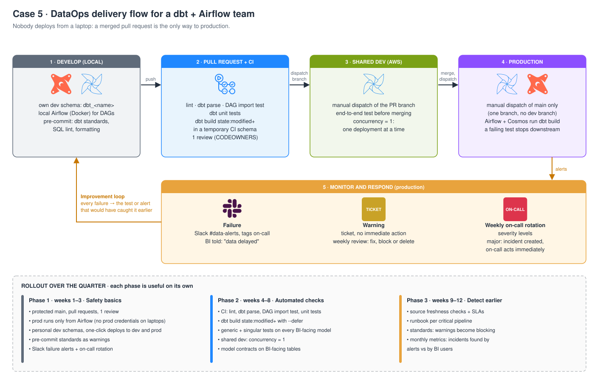

# Case 5: Setting up DataOps for a dbt + Airflow Team

> **Goal:** move a 6-person team from manual deployments to a safe, automated way of shipping its ~20 dbt + Airflow pipelines, so incidents are caught by the team before BI users see them.
> **Today:** `dbt run` from laptops, direct push to `main`, no automated tests, no staging, incidents reported by BI.
> **Constraints:** end of the quarter (~12 weeks) · the team has never done CI/CD · no stack constraint.

---

## 1. Target setup

One rule sums it up: **nobody deploys from a laptop. A merged pull request is the only way to production.**



| Concern | Stack |
|---|---|
| Code and reviews | **GitHub**: protected `main`, pull requests, 1 approval, `CODEOWNERS` per area |
| Local checks | **pre-commit**: dbt standards, SQL lint (SQLFluff), YAML and formatting, on every commit |
| CI/CD | **GitHub Actions** (the same works in GitLab CI): checks on every pull request, deploy workflows per environment |
| Environments | **local** (personal dev schema + local Airflow), **shared dev** on AWS for end-to-end checks, **prod** |
| Orchestration | **Apache Airflow + Cosmos**: the only place production dbt runs; each model and test is a task |
| Data quality | **dbt tests**: generic tests in YAML, singular tests, unit tests (in CI), source freshness |
| Alerting | **Airflow → Slack**: failures tag the on-call person; BI is told when data is delayed |

---

## 2. What I start with, and what I deliberately don't do yet

The order follows one principle: **first stop the bleeding, then automate the checks, then detect earlier.** Each phase is useful on its own, so if the quarter gets tight, what's done still helps.

### Phase 1 (weeks 1–3): safety basics

- **Production runs only from Airflow.** All 20 pipelines run on schedule in Airflow, and **production credentials are removed from laptops**. That's what makes the rule real, not just a convention.
- **Protect `main` and work in branches.** No direct pushes; every change goes through a pull request with one review. For a team new to Git workflows, I run a short hands-on session: branch → pull request → review → merge.
- **Separate dev and prod.** Each developer builds and tests dbt in a **personal dev schema** (`dbt build --target dev` writes to `dbt_<name>`), so nobody tests on production tables and nobody blocks a colleague.
- **One branch, `main`, and one deployment pipeline per environment:**
  - **shared dev:** a **manual dispatch of the pull request branch**, for an end-to-end test **before merging**. Manual on purpose: dev is used only when a change needs it, and nobody overwrites a colleague's test
  - **prod:** a **manual dispatch of `main`**, restricted by GitHub environment rules, so a feature branch can't reach production by mistake
  - **No `dev` branch:** with 6 people it would collect unfinished work and drift from `main`. Testing the pull request branch on dev gives the same safety with a single branch
- **pre-commit standards, as warnings first.** Naming, required tests and docs, SQL style. They warn without blocking at first, with the existing problems listed in a baseline file, so the team isn't buried under legacy issues on day one.
- **Alerting and on-call from day one.** Airflow failures go to a Slack channel and tag the on-call person. The team hears about failures before BI does.

### Phase 2 (weeks 4–8): automated checks on every pull request

- **CI workflow** (target: under 10 minutes):
  - SQL lint and `dbt parse`
  - **Airflow DAG checks:** every DAG imports without errors and has an owner, retries and no cycles
  - **dbt unit tests:** they check logic on fixed input data, so they belong here, before merge, not in the daily run
  - `dbt build --select state:modified+ --defer` in a temporary CI schema: builds and tests the changed models **and everything downstream of them**
- **Tests extended** to all models used by BI (generic tests in YAML, singular tests for business rules).
- **Shared dev limited to one deployment at a time** (`concurrency: 1`).
- **Model contracts** on the tables BI uses: column names and types are enforced.

### Phase 3 (weeks 9–12): detect earlier, respond faster

- **Source freshness checks** before each pipeline, so "the source is late" isn't confused with "our code is broken".
- **SLA per critical pipeline** (for example "sales mart ready by 07:00"), with an alert when missed.
- **A runbook per critical pipeline:** what it does, who owns it, the usual failures, how to re-run or backfill.
- **pre-commit warnings become blocking**, once the team is used to them.
- **Simple monthly metrics:** incidents found by alerts vs by BI users, failed deployments, time to fix.

### Deliberately not now

| Not now | Why |
|---|---|
| Automatic deployments (continuous deployment) | Two one-click deployments are easy to learn and keep dev under control; automate once the team trusts the pipeline |
| A full permanent staging environment | Personal schemas, CI schemas and the shared dev cover the need without a third environment to maintain |
| A paid data observability tool | dbt tests, freshness and Slack alerts come first; revisit if incidents still slip through |
| Data contracts with source teams | Valuable, but depends on other teams; start with contracts on our own output tables |
| 100% test coverage | Tests where a failure hurts BI first; coverage grows with each pull request |
| Re-platforming (dbt Cloud, Kubernetes, a new orchestrator) | Changes tools while changing habits; the problem is the process, not the stack |
| Blocking standards from day one | Would frustrate a team new to this; warnings first, then enforce |

---

## 3. How a change can't silently break production

### What CI does on every push to a pull request

GitHub starts a temporary machine, installs the tools, runs the checks, then throws the machine away. Each workflow runs only when its files change.

**Airflow** ([ci-airflow.yml](templates/.github/workflows/ci-airflow.yml), [test_dag_integrity.py](templates/tests/test_dag_integrity.py))
- Installs the **same Airflow version as prod** and loads every DAG, the way the scheduler would. No Airflow server needed.
- Fails on **import errors** (syntax, missing imports, cycles, duplicate DAG ids) and on **team rules**: real owner, tags, retries, catchup off, **a failure alert set**.

**dbt** ([ci-dbt.yml](templates/.github/workflows/ci-dbt.yml))
1. **Lint** the SQL.
2. **Download the prod `manifest.json` from S3.** dbt writes this file on every parse; it lists every model with a fingerprint of its code. The prod deploy saves it after each release.
3. **Compare** the branch with it: `state:modified` finds new or changed models, `+` adds everything downstream.
4. **Build and test** only those models in a temporary schema, `ci_pr_<number>`, in the prod warehouse. Unchanged parents are read from the prod tables (`--defer`), so the test runs on **real data without touching any prod table**:

   ```bash
   dbt build --select state:modified+ --defer --state prod-artifacts --target ci
   ```

   Example: change `stg_trades` → CI builds and tests `stg_trades`, `fct_trades` and `mart_volume` in `ci_pr_123`, reading their unchanged parents from prod.
5. **Drop** the CI schema.

Unit tests run in step 4: they use fake input rows from YAML, so they check the logic before merge.

**What this needs, once:**
- a **`ci` target** ([profiles.yml](templates/dbt/profiles.yml)) and a **CI database user**: read on prod, write on `ci_*` schemas only
- a **schema macro** ([generate_schema_name.sql](templates/dbt/macros/generate_schema_name.sql)) so custom schemas are used only in prod; in dev and CI everything goes to the target schema
- the **prod deploy uploads the manifest** ([deploy.yml](templates/.github/workflows/deploy.yml))

### All the safety layers

1. **Local:** pre-commit standards on every commit; builds in a personal dev schema.
2. **CI:** DAG integrity, SQL lint, unit tests, changed models and everything downstream built and tested on prod data.
3. **Model contracts** on the tables BI uses: a broken column name or type fails the build.
4. **Review:** `CODEOWNERS` routes the pull request to someone who knows the area.
5. **Shared dev:** the pull request branch is deployed for a final end-to-end check before merging, mainly for DAG changes.
6. **In production, `dbt build` stops at the first failing test.** Downstream models aren't updated: BI keeps yesterday's correct data and gets a "data delayed" message.

### Templates

Example files in [templates/](templates/), ready to adapt:

| File | Purpose |
|---|---|
| [ci-dbt.yml](templates/.github/workflows/ci-dbt.yml) | dbt CI: lint, prod manifest, build and test changed models in `ci_pr_<number>` |
| [ci-airflow.yml](templates/.github/workflows/ci-airflow.yml) | Airflow CI: DAG integrity tests |
| [deploy.yml](templates/.github/workflows/deploy.yml) | Manual dispatch: any branch → dev, `main` only → prod; one deployment at a time; saves the manifest |
| [test_dag_integrity.py](templates/tests/test_dag_integrity.py) | Import errors and team rules for every DAG |
| [profiles.yml](templates/dbt/profiles.yml) | `dev`, `ci` and `prod` targets |
| [generate_schema_name.sql](templates/dbt/macros/generate_schema_name.sql) / [drop_ci_schema.sql](templates/dbt/macros/drop_ci_schema.sql) | Keep CI out of prod schemas; clean up after CI |

They sit in `templates/` rather than the repository's own `.github/`, so GitHub doesn't run them here.

---

## 4. Six people, one shared dev: avoiding conflicts

With 6 people, queuing for one shared dev environment quickly becomes the bottleneck. The answer is to **need the shared dev less often**:

| Change | Where it's tested | Shared dev needed? |
|---|---|---|
| dbt model | Personal dev schema, then the CI schema of the pull request | No |
| DAG | Local Airflow (Docker), then shared dev | Yes, for the final check |
| Infrastructure | `terraform plan` on the pull request, then shared dev | Yes |

- **Most changes are dbt changes**, so most work never touches the shared dev.
- **One deployment at a time:** `concurrency: 1` on the dev deploy workflow, plus a simple Slack convention ("I'm on dev until 3 p.m.").
- **Reviews are spread out:** `CODEOWNERS` assigns an owner per area, so reviews don't all land on one person.

---

## 5. Keeping CI/CD an accelerator, not a blocker

The risk with a team new to CI/CD is a pipeline that feels like a gate nobody understands. How I avoid that:

- **Start with one pilot pipeline**, chosen with the team, before rolling out to all 20. The team sees it work before it applies to everyone.
- **Pair on the first pull requests:** I pair with each person on their first changes through the new flow.
- **Same checks locally and in CI:** pre-commit catches most issues before pushing, so CI failures are rare and never a surprise.
- **Fast and readable CI:** under 10 minutes, with clear failure messages. A slow or cryptic CI is the fastest way to lose the team.
- **Warn first, then enforce:** new standards and tests start as warnings and become blocking once the team trusts them.
- **Templates, not documentation to memorise:** a pull request template, reusable workflows, and a one-page "how we ship".
- **Share business knowledge:** short sessions where each owner explains their domain. Good tests come from knowing what "correct data" means.
- **Show the result:** share the monthly metrics (fewer incidents found by BI). Seeing the benefit is what makes the habit stick.

---

## 6. A pipeline fails in prod at 6 a.m.

**Alerts go to the person, not the other way round.** No one has to check emails or dashboards at 6 a.m.

| | Today | With DataOps |
|---|---|---|
| **Detection** | A BI user notices wrong numbers around 9–10 a.m. | Slack alert in `#data-alerts`: DAG, failed task, error, log link, and the **on-call person tagged**. Everyone sees it; one person owns it |
| **Impact** | Wrong or partial data may already be in dashboards | `dbt build` stopped before publishing; dashboards show yesterday's correct data |
| **Communication** | BI asks the team what happened | BI is told first, automatically: "data delayed, we'll notify you when ready" |
| **Diagnosis** | Someone reruns things on a laptop | Freshness check says if it's the source or our code; the failed model is one task in Airflow; the runbook lists the usual causes |
| **Fix** | Manual `dbt run` from a laptop | Retry the task in Airflow, or fix through a pull request; backfill only the affected dates |
| **Follow-up** | Nothing, until it happens again | Ask: **which test or alert would have caught this earlier?** Then add it |

**Severity levels, so the response matches the problem:**

| Level | Example | Response |
|---|---|---|
| **Warning** | A test with `warn` severity fails, a run is slow | A ticket so it isn't forgotten; reviewed weekly. A warning that keeps coming back gets a decision: fix the cause, make it blocking, or delete the test if it's noise |
| **Failure** | Pipeline stopped, data delayed | The on-call person fixes it, alone or with the pipeline owner; BI kept informed |
| **Major** | Wrong data reached dashboards | An incident is created and the on-call developer acts immediately, involving the pipeline owner or the team if needed |

- **Weekly on-call rotation:** with 6 people, each person is on call one week in six. That's sustainable, and everyone learns every pipeline.
- **Retries** handle transient errors (timeouts, throttling) automatically, so people are only called for real problems.
- **When the cause is upstream** (a late or broken source), the improvement loop still applies: detect it earlier (source freshness, checks at ingestion), stop before publishing bad data, and raise it with the source owner.

---

## 7. Trade-offs

| Choice | Benefit | Cost / risk | Mitigation |
|---|---|---|---|
| Pull requests and reviews on every change | Fewer incidents, shared knowledge | Changes take a bit longer to ship | Small pull requests, same-day reviews |
| Manual deployments to dev and prod | Controlled releases; who deployed what is visible; dev never overwritten by surprise | One more step than full automation | One click each; prod restricted to `main`; automate later once trust is built |
| CI against prod data with `--defer` | Realistic tests, fast CI | CI needs read access to prod data | Read-only CI role; sensitive data masked or hashed upstream |
| One branch (`main`), no `dev` branch | One review per change, small releases, no drift between branches | No built-in batch of approved changes | Dev test of the branch before merging; a weekly release is still possible by dispatching `main` to prod on a fixed day |
| No permanent staging | Less to maintain, cheaper | No full rehearsal for every change | Shared dev for end-to-end checks on DAG and infrastructure changes |
| Standards and tests start as warnings | Adoption without frustration | Some issues pass at first | Warnings become tickets; made blocking in phase 3 |
| Phased rollout | The team learns gradually | Some risk remains in the first weeks | Protected `main`, no prod credentials on laptops, and alerts come first: they remove the biggest risks |

---

## 8. Assumptions and questions for day 1

| Topic | Assumption | If it's wrong |
|---|---|---|
| Repository | dbt and DAGs in one repository | Same approach per repository, with shared reusable workflows |
| Airflow | One Airflow per environment (dev, prod), deployed from the repository | Same CI/CD; only the deploy step changes |
| Warehouse | Separate dev and prod schemas or databases are possible | Separate accounts make isolation even simpler |
| Team | 6 people, mixed experience, all writing dbt | Adjust pairing and the pace of the rollout |
| Criticality | A few pipelines feed key dashboards | Prioritise tests and SLAs on those first |

**Questions for day 1:** Which pipelines and dashboards matter most to the business? What were the last 3 incidents, and how were they found? Who has prod access today? How is Airflow deployed and hosted? Is there a code review culture already?
